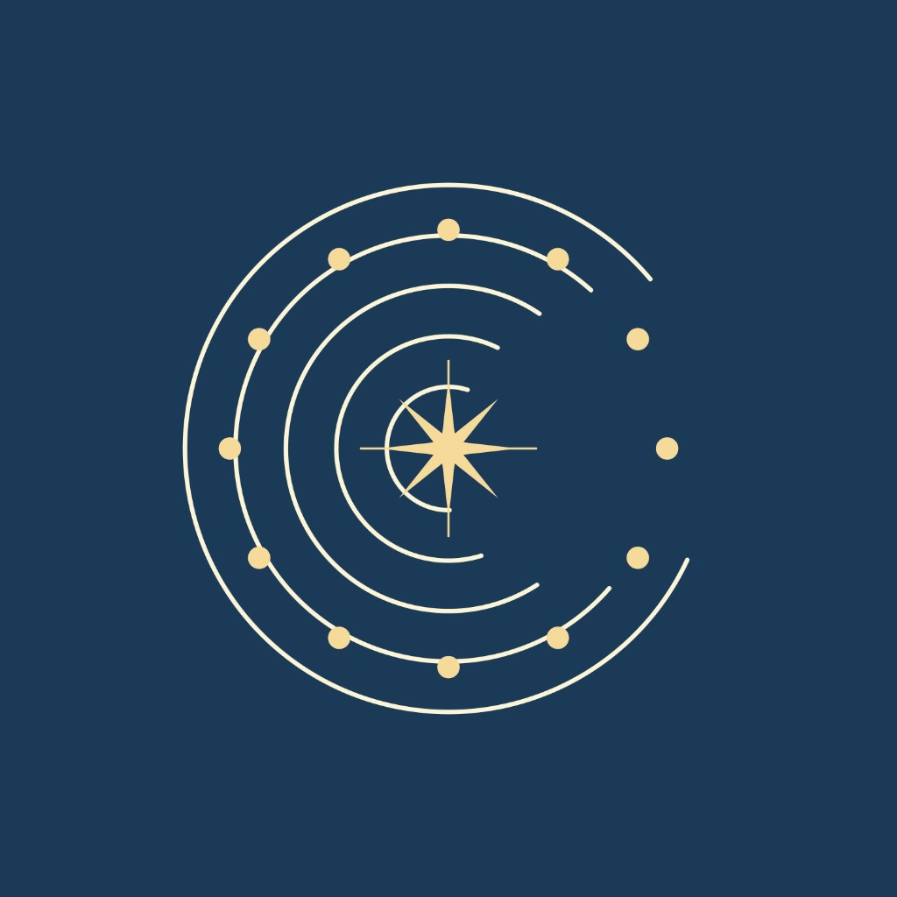

<p align="center">
  
</p>

<h1 align="center">Momentia</h1>

<p align="center">
  <strong>Turn a meaningful night into a printable star poster.</strong>
</p>

<p align="center">
  <em>آسمان شب ما — “Our Night Sky”</em>
</p>

<p align="center">
  <a href="#-getting-started"></a> 
  <a href="#-getting-started"></a> 
  <a href="#-stack"></a> 
  <a href="#-localization"></a>
</p>

---

Momentia takes a date and a place, computes the real sky of that night, and draws it as a poster you can download as PNG or SVG.

✨ No accounts · 🖥️ The sky and the poster are computed in your browser · 💳 Optional premium download via Zarinpal

---

## ✨ Features

|     | Area             | What it does                                                                                                                      |
| --- | ---------------- | --------------------------------------------------------------------------------------------------------------------------------- |
| 🌌  | **Sky engine**   | Stars, constellations, Sun, Moon (with phase), planets, ecliptic and equator from date + location; north up, east on the left      |
| 🎛️  | **Sky options**  | Toggle constellation lines, Moon and planets, planet names, ecliptic, equator, and star density                                   |
| 🖼️  | **Layouts**      | **Round chart** (free) and **Full-page sky** (premium), the whole poster is sky with the text over it                            |
| 🎨  | **Styles**       | Five colour styles: navy & gold, black & white, black & silver, parchment, violet                                                 |
| 📥  | **Downloads**    | Free: watermarked PNG / SVG / share (round layout only). Premium: watermark-free 3000px PNG, available for both layouts          |
| 🗂️  | **Gallery**      | `/posters` lists every layout in every style and opens the create flow with that look preselected                                 |
| 🇮🇷  | **Locale**       | Persian UI (`fa`), RTL, Vazirmatn, Jalali calendar                                                                                |

### Create flow

1. **Moment**: city, Jalali date, optional time.
2. **Personalize**: title, names, short line, layout, style, sky options.
3. **Receive**: download. The full-page layout has no free download; the free buttons are disabled and the watermark-free premium file is offered instead.

`/create?style=violet&template=full` starts the flow with that style and layout.

---

## 🛠️ Stack

- **Next.js** (App Router) + TypeScript + Tailwind CSS
- **[shadcn/ui](https://ui.shadcn.com/docs/components)** (Radix, RTL)
- **[next-intl](https://next-intl.dev)** — Persian only for now
- **react-hook-form** + **zod** for the forms
- **Zarinpal** for the premium download (server routes under `src/app/api/payments`)
- **Vazirmatn** via `next/font`
- Root RTL (`dir="rtl"` + `DirectionProvider`)

---

## 📁 Project structure

```text
docs/
  logo.jpg                # Brand mark
messages/
  fa.json                 # UI translations
src/
  app/                    # Pages (/, /create, /posters) and payment API routes
  components/ui/          # shadcn/ui primitives
  features/
    sky/                  # Sky math (projection, ephemeris) + SVG chart
    poster/               # Poster themes, layouts, preview + PNG/SVG export
    payments/             # Zarinpal checkout and premium token
    home/                 # Landing page sections and the posters gallery
  i18n/                   # next-intl config
  lib/                    # Shared utilities
```

---

## 🚀 Getting started

**Requirements:** Node.js 20+

```bash
npm install
npm run dev
```

Open [http://localhost:3000](http://localhost:3000) ✨

| Script          | Description                  |
| --------------- | ---------------------------- |
| `npm run dev`   | Start the development server |
| `npm run build` | Production build             |
| `npm run start` | Serve the production build   |
| `npm run lint`  | Run ESLint                   |
| `npm test`      | Run the unit tests           |

### Premium payments

Copy `.env.example` to `.env.local` and fill it in. Without a payment secret the premium button reports that checkout is unavailable; everything else works.

| Variable                        | Purpose                                              |
| ------------------------------- | ---------------------------------------------------- |
| `NEXT_PUBLIC_PREMIUM_PRICE_IRT` | Premium price in tomans                              |
| `ZARINPAL_MERCHANT_ID`          | Merchant id (any UUID works in sandbox)              |
| `ZARINPAL_SANDBOX`              | `true` to use the Zarinpal sandbox                   |
| `PAYMENT_TOKEN_SECRET`          | 32+ random characters, signs the premium token       |
| `SITE_URL`                      | Optional public origin used for the payment callback |

> The free files are generated in the browser, so the lock on the full-page layout is a product gate, not a security boundary. Only the watermark-free premium file is checked against the server-validated token.

---

## 🌍 Localization

Strings live in `messages/fa.json`.

- Server components → `getTranslations`
- Client components → `useTranslations`

To add another language later: add `messages/<locale>.json`, extend `locales` in `src/i18n/config.ts`, and resolve the locale in `src/i18n/request.ts`.

---

## 📄 License

Private project — all rights reserved.
