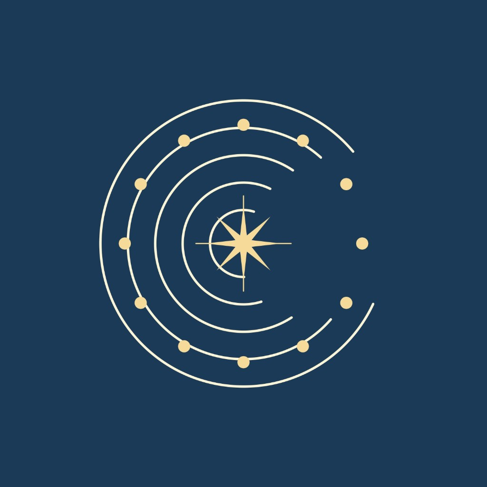

<p align="center">
  
</p>

<h1 align="center">Momentia</h1>

<p align="center">
  <strong>Turn a meaningful night into a printable star poster.</strong>
</p>

<p align="center">
  <em>آسمان شب ما — “Our Night Sky”</em>
</p>

<p align="center">
  <a href="#-getting-started"></a> 
  <a href="#-getting-started"></a> 
  <a href="#-stack"></a> 
  <a href="#-localization"></a>
</p>

---

Momentia takes a date and a place, computes the real sky of that night, and draws it as a poster you can download as PNG or SVG.

✨ No accounts · 🖥️ The sky and the poster are computed in your browser · 💳 Optional premium download, paid card-to-card and approved by hand on Telegram

---

## ✨ Features

|     | Area             | What it does                                                                                                                      |
| --- | ---------------- | --------------------------------------------------------------------------------------------------------------------------------- |
| 🌌  | **Sky engine**   | Stars, constellations, Sun, Moon (with phase), planets, ecliptic and equator from date + location; north up, east on the left      |
| 🎛️  | **Sky options**  | Toggle constellation lines, Moon and planets, planet names, ecliptic, equator, and star density                                   |
| 🖼️  | **Layouts**      | **Round chart** (free) and **Full-page sky** (premium), the whole poster is sky with the text over it                            |
| 🎨  | **Styles**       | Five colour styles: navy & gold, black & white, black & silver, parchment, violet                                                 |
| 📥  | **Downloads**    | Free: watermarked PNG / SVG / share (round layout only). Premium: watermark-free 3000px PNG, available for both layouts          |
| 🌕  | **Moon poster**  | A second product at `/moon`: one big real photo of the Moon with the phase it really had that night (phase name and % lit), same 3-step flow, five styles |
| 🚀  | **Space home**   | The landing page floats in space: a canvas starfield with depth, streaks as you scroll, shooting stars, a nebula and the real Moon receding down the page (GSAP; respects reduced motion) |
| 🗂️  | **Gallery**      | `/posters` lists every layout in every style and opens the create flow with that look preselected                                 |
| 🇮🇷  | **Locale**       | Persian UI (`fa`), RTL, Vazirmatn, Jalali calendar                                                                                |

### Create flow

1. **Moment**: city, Jalali date, optional time.
2. **Personalize**: title, names, short line, layout, style, sky options.
3. **Receive**: download. The full-page layout has no free download; the free buttons are disabled and the watermark-free premium file is offered instead.

`/create?style=violet&template=full` starts the flow with that style and layout.

### Moon poster (`/moon`)

The same three steps (moment → personalize → receive) for a poster that is only the Moon. The phase is computed for the chosen date, time and city; the surface is a real photograph-style disc of the near side (`public/moon/moon-nearside.jpg`) and the unlit part is drawn over it. South of the equator the Moon is turned upside down, as it appears there. Free and premium downloads work as for the sky poster, and the buyer returns to `/moon` after paying.

---

## 🛠️ Stack

- **Next.js** (App Router) + TypeScript + Tailwind CSS
- **[shadcn/ui](https://ui.shadcn.com/docs/components)** (Radix, RTL)
- **[next-intl](https://next-intl.dev)** — Persian only for now
- **react-hook-form** + **zod** for the forms
- Card-to-card checkout for the premium download: orders in **Upstash Redis**, approval through a **Telegram bot** (server routes under `src/app/api/payments`)
- **Vazirmatn** via `next/font`
- Root RTL (`dir="rtl"` + `DirectionProvider`)

---

## 📁 Project structure

```text
docs/
  logo.jpg                # Brand mark
messages/
  fa.json                 # UI translations
src/
  app/                    # Pages (/, /create, /posters) and payment API routes
  components/ui/          # shadcn/ui primitives
  features/
    sky/                  # Sky math (projection, ephemeris) + SVG chart
    poster/               # Poster themes, layouts, preview + PNG/SVG export
    payments/             # Card-to-card orders, Telegram approval and premium token
    home/                 # Landing page sections and the posters gallery
  i18n/                   # next-intl config
  lib/                    # Shared utilities
```

---

## 🚀 Getting started

**Requirements:** Node.js 20+

```bash
npm install
npm run dev
```

Open [http://localhost:3000](http://localhost:3000) ✨

| Script          | Description                  |
| --------------- | ---------------------------- |
| `npm run dev`   | Start the development server |
| `npm run build` | Production build             |
| `npm run start` | Serve the production build   |
| `npm run lint`  | Run ESLint                   |
| `npm run typecheck` | Type-check with `tsc`    |
| `npm test`      | Run the unit tests           |

### Premium payments

The watermark-free download is paid **card-to-card** and approved **by hand on Telegram**. No payment gateway is involved: banks give no API to see a deposit on a personal card, so the owner checks the deposit and confirms it.

Copy `.env.example` to `.env.local` and fill it in. Without the payment settings the premium button reports that checkout is unavailable; everything else works.

| Variable                                         | Purpose                                                      |
| ------------------------------------------------ | ------------------------------------------------------------ |
| `NEXT_PUBLIC_PREMIUM_PRICE_IRT`                  | Premium price in tomans (each order adds 1 to 99 tomans)     |
| `PAYMENT_CARD`                                   | 16-digit card buyers pay into                                |
| `PAYMENT_CARD_HOLDER` / `PAYMENT_CARD_BANK`      | Optional, shown next to the number                           |
| `TELEGRAM_BOT_TOKEN`                             | Bot token from @BotFather                                    |
| `TELEGRAM_CHAT_ID`                               | Your own numeric chat id; only you can approve               |
| `TELEGRAM_WEBHOOK_SECRET`                        | 16+ random characters (`A-Za-z0-9_-`), given to `setWebhook` |
| `UPSTASH_REDIS_REST_URL` / `_TOKEN`              | Upstash Redis REST credentials (`KV_REST_API_*` also work)   |
| `PAYMENT_TOKEN_SECRET`                           | 32+ random characters, signs the premium token               |

**How a payment flows.**

1. The buyer taps the premium button. `POST /api/payments/start` creates an order in Redis with an exact amount (the price plus 1 to 99 tomans, reserved so no two open orders share it) and sets an HttpOnly `mm_order` cookie. The window shows the amount and the card.
2. After paying in their bank app the buyer taps "I paid" (optionally typing the last 4 digits of their card). `POST /api/payments/submit` sends you a Telegram message with the amount, the order code and ✅ / ❌ buttons.
3. You check the deposit in your bank app and press a button. Telegram calls `POST /api/payments/telegram` (checked with the secret token, and only your account counts); the order becomes `paid` or `rejected`, and the buttons are replaced by the outcome.
4. The page asks `POST /api/payments/claim` every few seconds while it waits. On `paid` it receives the signed premium token (2 hours) that unlocks the download. An unpaid order and its amount are held for 1 hour, a submitted one for 24 hours, so a buyer can come back the next day in the same browser.

**One-time Telegram setup.**

1. Create a bot with @BotFather and copy its token. Send the bot any message so it can write to you.
2. Get your numeric chat id (for example from @userinfobot) and set it as `TELEGRAM_CHAT_ID`.
3. After deploying, register the webhook once (replace the three values):

   ```bash
   curl "https://api.telegram.org/bot<TELEGRAM_BOT_TOKEN>/setWebhook" \
     -d "url=https://<your-domain>/api/payments/telegram" \
     -d "secret_token=<TELEGRAM_WEBHOOK_SECRET>" \
     -d 'allowed_updates=["callback_query"]'
   ```

4. Check everything (token, chat id, webhook and secret) with one command; it prints what to fix and never prints a secret. `--send` also sends a test message:

   ```bash
   TELEGRAM_BOT_TOKEN=... TELEGRAM_CHAT_ID=... TELEGRAM_WEBHOOK_SECRET=... \
   SITE_URL=https://<your-domain> node scripts/check-telegram.mjs --send
   ```

If a buyer taps "I paid" and no message arrives, the Vercel function log has a line starting with `telegram notify failed:` that names the cause (wrong chat id, bot never started, wrong token, network).

On Vercel, add the Upstash Redis integration from the Marketplace for the store. Because the owner approves each payment by hand, payments are as quick as you are; a buyer whose deposit is rejected is pointed to `/contact`.

### Support, contact and donations

`/contact` shows the contact channels and an optional card-to-card donation box; `/terms` explains what is sold and the refund rules. Both are filled from public env variables, so nothing personal is committed to the repository. Anything left empty is hidden, and the donation link in the footer only appears once a valid card is set.

| Variable                        | Purpose                                                    |
| ------------------------------- | ---------------------------------------------------------- |
| `NEXT_PUBLIC_CONTACT_EMAIL`     | Support email                                              |
| `NEXT_PUBLIC_CONTACT_TELEGRAM`  | Telegram username (with or without `@`)                    |
| `NEXT_PUBLIC_CONTACT_INSTAGRAM` | Instagram username (with or without `@`)                   |
| `NEXT_PUBLIC_DONATION_CARD`     | 16-digit card number for donations                         |
| `NEXT_PUBLIC_DONATION_HOLDER`   | Card holder name shown under the number                    |
| `NEXT_PUBLIC_DONATION_BANK`     | Bank name shown under the number                           |

After a premium payment the create page shows the payment's tracking code, so a buyer who loses the tab can still get help from `/contact`.

> The free files are generated in the browser, so the lock on the full-page layout is a product gate, not a security boundary. Only the watermark-free premium file is checked against the server-validated token.

---

## 🌕 Moon image

`public/moon/moon-nearside.jpg` is the Earth-facing side of the Moon, projected from the 4096×2048 equirectangular map `textures/moon_4k.jpg` of the [Stellarium](https://github.com/Stellarium/stellarium) repository (orthographic view, north up, contrast stretched). Check that map's licence before using the poster commercially, or replace the image with one you hold the rights to (for example NASA's CGI Moon Kit); the file name and size are all the code relies on.

---

## 🌍 Localization

Strings live in `messages/fa.json`.

- Server components → `getTranslations`
- Client components → `useTranslations`

To add another language later: add `messages/<locale>.json`, extend `locales` in `src/i18n/config.ts`, and resolve the locale in `src/i18n/request.ts`.

---

## 📄 License

Private project — all rights reserved.
