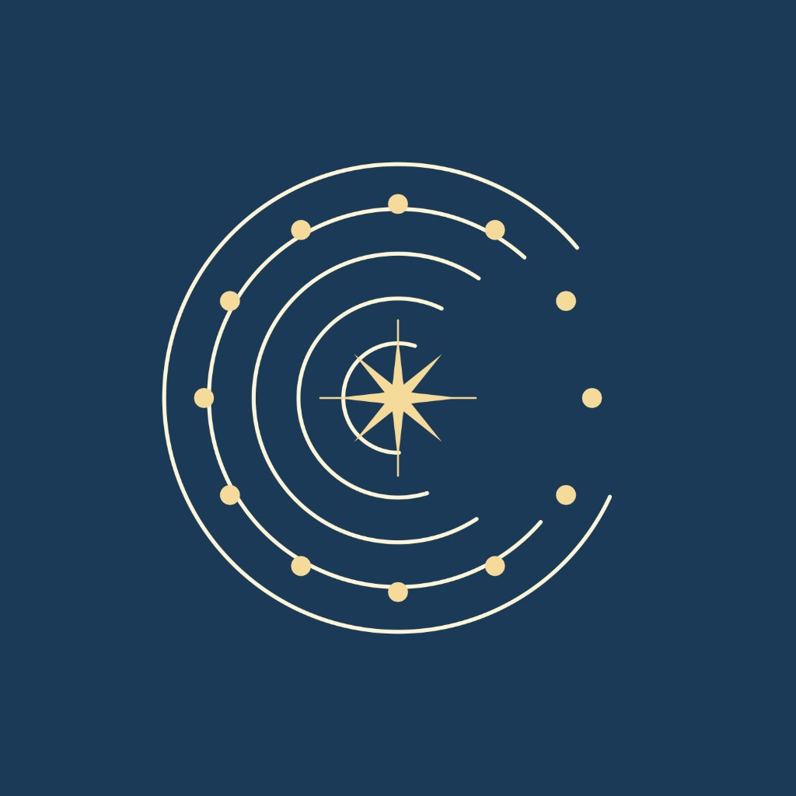

<p align="center">
  
</p>

<h1 align="center">Momentia</h1>

<p align="center">
  <strong>Turn a meaningful night — or a whole story — into a printable keepsake.</strong>
</p>

<p align="center">
  <em>آسمان شب ما — “Our Night Sky”</em>
</p>

<p align="center">
  <a href="#-getting-started"></a>
  <a href="#-getting-started"></a>
  <a href="#-stack"></a>
  <a href="#-localization"></a>
</p>

---

Momentia is a Persian (RTL) keepsake shop with three products: the **real night sky** of a chosen date and place, a **Moon poster** with that night’s true phase, and a **treasure map** of life milestones. No accounts. The sky, the Moon and the map are drawn in the browser. Optional premium downloads are paid card-to-card and approved by hand on Telegram.

✨ No accounts · 🖥️ Computed in your browser · 💳 Optional premium download, paid card-to-card and approved on Telegram · 🎁 Gift links for Telegram and WhatsApp

---

## ✨ Products

|     | Product            | Route      | What it does                                                                                                                                 |
| --- | ------------------ | ---------- | -------------------------------------------------------------------------------------------------------------------------------------------- |
| 🌌  | **Night sky**      | `/create`  | Stars, constellations (optional painted figures), Sun, Moon with phase, planets, ecliptic and equator from date + city; north up             |
| 🌕  | **Moon**           | `/moon`    | One large near-side Moon photo with the real phase for that night (name + % lit); southern latitudes flip the disc as it appears there       |
| 🗺️  | **Treasure map**   | `/map`     | A premium keepsake of 2–8 moments: city or Iran scope, Leaflet place picker, washed OSM tiles, or an illustrated winding road of pictures   |

### Shared across products

|     | Area              | What it does                                                                                                                          |
| --- | ----------------- | ------------------------------------------------------------------------------------------------------------------------------------- |
| 🎨  | **Styles**        | Sky & Moon: five colour styles (navy & gold, black & white, black & silver, parchment, violet). Map: paper, blush, night, ink        |
| 🖼️  | **Layouts**       | Sky: **round chart** (free) and **full-page sky** (premium). Map: **single**, **per-moment cards**, **illustrated road**             |
| 🖼️  | **Frames**        | Classic, minimal, double, stars, rounded, deco, or none                                                                               |
| 📥  | **Downloads**     | Free: watermarked PNG / SVG / share (where offered). Premium: watermark-free high-res PNG, story, wallpaper, and print PDF sizes      |
| 🛋️  | **Wall preview**  | Toggle between the flat poster and a framed print hanging on a real living-room photo                                                 |
| 🎁  | **Gift link**     | Share a private `/gift` URL so the recipient sees the poster; also share via Telegram and WhatsApp                                    |
| 🗂️  | **Gallery**       | `/posters` lists every product look and opens the matching create flow with that look preselected                                     |
| 🇮🇷  | **Locale**        | Persian UI (`fa`), RTL, Vazirmatn / IranYekan, Jalali calendar (Gregorian entry also available)                                       |

### Create flow (sky, moon, map)

1. **Moment** — city / places, Jalali (or Gregorian) date, optional time; map adds milestones and a place picker.
2. **Personalize** — title, names, short line, layout, style, frame, and product-specific options; live preview (including a floating chip on phones).
3. **Receive** — free or premium download, wall preview, gift link. Full-page sky and the treasure map are premium-gated.

Deep links:

- `/create?style=violet&template=full` — sky with that style and layout
- `/create?moment=yalda` / `/moon?moment=yalda` — start on Yalda night
- `/create?occasion=birthday` (also `anniversary`, `newborn`, `wedding`) — ready-made wording from `/occasions/<slug>`

---

## 🗺️ Treasure map (`/map`)

A three-step creator for a map of life moments (premium-only download).

| Choice    | Options                                                                 |
| --------- | ----------------------------------------------------------------------- |
| **Layout** | `single` (one map), `cards` (2–4 small maps with captions), `road` (illustrated winding path) |
| **Scope**  | A city street map, or a light Iran silhouette                           |
| **Shape**  | Circle, heart, arch, square (for map cuts)                              |
| **Theme**  | Paper, blush, night, ink                                                |

The **illustrated road** layout places each moment along a hand-drawn path with either a bright flat icon (~56) or a watercolour picture (~99), grouped by theme (love, travel, home, celebration, …). City maps use the same OpenStreetMap-style tiles as the Leaflet picker, washed to one soft tone; tile URLs are configurable (see env below).

---

## 🌕 Moon poster (`/moon`)

Same three steps as the sky poster. Phase is computed for the chosen date, time and city; the surface is `public/moon/moon-nearside.jpg`. Free and premium downloads, wall preview and gift links work as for the sky poster.

---

## 🎄 Seasonal & occasion pages

| Route                    | Purpose                                                                 |
| ------------------------ | ----------------------------------------------------------------------- |
| `/yalda`                 | Yalda gift landing (countdown, CTAs into sky/moon with Yalda prefilled). Campaign links hide after the night ends |
| `/occasions/[slug]`      | Birthday, anniversary, newborn, wedding — each opens the create flow with ready-made starts |
| `/gift`                  | Recipient view of a shared poster (not indexed)                         |
| `/track`                 | Recover a premium order by tracking code (not indexed)                  |
| `/contact` · `/terms` · `/privacy` | Support channels, refund rules, privacy                             |

---

## 🛠️ Stack

- **Next.js 16** (App Router) + **React 19** + TypeScript + Tailwind CSS 4
- **[shadcn/ui](https://ui.shadcn.com/docs/components)** (Radix / Base UI, RTL)
- **[next-intl](https://next-intl.dev)** — Persian only for now
- **react-hook-form** + **zod** for forms
- **Leaflet** for the treasure-map place picker; map tiles washed onto the poster
- **GSAP** for the home space backdrop (respects reduced motion)
- Card-to-card checkout: orders in **Upstash Redis**, approval through a **Telegram bot** (`src/app/api/payments`)
- Persian fonts via `next/font` / `next-persian-fonts`
- Root RTL (`dir="rtl"`)
- Package manager: **pnpm**

---

## 📁 Project structure

```text
docs/
  logo.jpg                   # Brand mark
messages/
  fa.json                    # UI translations
public/
  moon/                      # Near-side Moon photo
  constellation-art/         # Optional painted constellation figures
  map/                       # Treasure-map illustrations & stickers
scripts/
  check-telegram.mjs         # One-shot Telegram / webhook health check
  build-sky-data.mjs         # Rebuild sky catalog data
src/
  app/                       # Routes (/, /create, /moon, /map, /posters, /yalda, …) + payment API
  components/ui/             # shadcn/ui primitives
  features/
    sky/                     # Sky math (projection, ephemeris) + SVG chart
    poster/                  # Sky poster themes, layouts, frames, export, gift, wall
    moon/                    # Moon phase, poster, export, gift
    treasure-map/            # Map layouts, tiles, road art, form, export, gift
    payments/                # Card-to-card orders, Telegram approval, premium token
    home/                    # Landing, gallery, Yalda campaign helpers
    support/                 # Contact helpers (e.g. missing-city note)
  i18n/                      # next-intl config
  lib/                       # Site URL, share metadata, support, utils
```

---

## 🚀 Getting started

**Requirements:** Node.js 20+, pnpm 9+

```bash
pnpm install
pnpm dev
```

Open [http://localhost:3000](http://localhost:3000).

| Script               | Description                    |
| -------------------- | ------------------------------ |
| `pnpm dev`           | Start the development server   |
| `pnpm build`         | Production build               |
| `pnpm start`         | Serve the production build     |
| `pnpm lint`          | Run ESLint                     |
| `pnpm typecheck`     | Type-check with `tsc`          |
| `pnpm test`          | Run the unit tests             |
| `pnpm build:sky-data`| Rebuild sky catalog assets     |

### Premium payments

The watermark-free download is paid **card-to-card** and approved **by hand on Telegram**. No payment gateway is involved: banks give no API to see a deposit on a personal card, so the owner checks the deposit and confirms it.

Copy `.env.example` to `.env.local` and fill it in. Without the payment settings the premium button reports that checkout is unavailable; everything else works.

| Variable                                         | Purpose                                                      |
| ------------------------------------------------ | ------------------------------------------------------------ |
| `NEXT_PUBLIC_PREMIUM_PRICE_IRT`                  | Premium price in tomans (each order adds 1 to 99 tomans)     |
| `PAYMENT_CARD`                                   | 16-digit card buyers pay into                                |
| `PAYMENT_CARD_HOLDER` / `PAYMENT_CARD_BANK`      | Optional, shown next to the number                           |
| `TELEGRAM_BOT_TOKEN`                             | Bot token from @BotFather                                    |
| `TELEGRAM_CHAT_ID`                               | Your own numeric chat id; only you can approve               |
| `TELEGRAM_WEBHOOK_SECRET`                        | 16+ random characters (`A-Za-z0-9_-`), given to `setWebhook` |
| `UPSTASH_REDIS_REST_URL` / `_TOKEN`              | Upstash Redis REST credentials (`KV_REST_API_*` also work)   |
| `PAYMENT_TOKEN_SECRET`                           | 32+ random characters, signs the premium token               |
| `SITE_URL`                                       | Optional public origin for absolute share / canonical URLs   |

**How a payment flows.**

1. The buyer taps the premium button. `POST /api/payments/start` creates an order in Redis with an exact amount (the price plus 1 to 99 tomans, reserved so no two open orders share it) and sets an HttpOnly `mm_order` cookie. The window shows the amount and the card.
2. After paying in their bank app the buyer taps "I paid" (optionally typing the last 4 digits of their card). `POST /api/payments/submit` sends you a Telegram message with the amount, the order code and ✅ / ❌ buttons.
3. You check the deposit in your bank app and press a button. Telegram calls `POST /api/payments/telegram` (checked with the secret token, and only your account counts); the order becomes `paid` or `rejected`, and the buttons are replaced by the outcome.
4. The page asks `POST /api/payments/claim` every few seconds while it waits. On `paid` it receives the signed premium token (2 hours) that unlocks the download. An unpaid order and its amount are held for 1 hour, a submitted one for 24 hours, so a buyer can come back the next day in the same browser. Lost tabs can recover via `/track` with the tracking code.

**One-time Telegram setup.**

1. Create a bot with @BotFather and copy its token. Send the bot any message so it can write to you.
2. Get your numeric chat id (for example from @userinfobot) and set it as `TELEGRAM_CHAT_ID`.
3. After deploying, register the webhook once (replace the three values):

   ```bash
   curl "https://api.telegram.org/bot<TELEGRAM_BOT_TOKEN>/setWebhook" \
     -d "url=https://<your-domain>/api/payments/telegram" \
     -d "secret_token=<TELEGRAM_WEBHOOK_SECRET>" \
     -d 'allowed_updates=["callback_query"]'
   ```

4. Check everything (token, chat id, webhook and secret) with one command; it prints what to fix and never prints a secret. `--send` also sends a test message:

   ```bash
   TELEGRAM_BOT_TOKEN=... TELEGRAM_CHAT_ID=... TELEGRAM_WEBHOOK_SECRET=... \
   SITE_URL=https://<your-domain> node scripts/check-telegram.mjs --send
   ```

If a buyer taps "I paid" and no message arrives, the Vercel function log has a line starting with `telegram notify failed:` that names the cause (wrong chat id, bot never started, wrong token, network).

On Vercel, add the Upstash Redis integration from the Marketplace for the store. Because the owner approves each payment by hand, payments are as quick as you are; a buyer whose deposit is rejected is pointed to `/contact`.

### Support, contact and donations

`/contact` shows the contact channels and an optional card-to-card donation box; `/terms` explains what is sold and the refund rules; `/privacy` covers what is (and isn’t) stored. All are filled from public env variables, so nothing personal is committed to the repository. Anything left empty is hidden, and the donation link in the footer only appears once a valid card is set.

| Variable                        | Purpose                                                    |
| ------------------------------- | ---------------------------------------------------------- |
| `NEXT_PUBLIC_CONTACT_EMAIL`     | Support email                                              |
| `NEXT_PUBLIC_CONTACT_TELEGRAM`  | Telegram username (with or without `@`)                    |
| `NEXT_PUBLIC_CONTACT_INSTAGRAM` | Instagram username (with or without `@`)                   |
| `NEXT_PUBLIC_DONATION_CARD`     | 16-digit card number for donations                         |
| `NEXT_PUBLIC_DONATION_HOLDER`   | Card holder name shown under the number                    |
| `NEXT_PUBLIC_DONATION_BANK`     | Bank name shown under the number                           |

### Treasure map tiles (optional)

By default the map poster uses OpenStreetMap’s own tile server (same look as the place picker), washed to one soft tone. For heavier traffic, point at a provider you have an account with and update the credit string under `MapPage.poster` in `messages/fa.json`.

| Variable                         | Purpose                                      |
| -------------------------------- | -------------------------------------------- |
| `NEXT_PUBLIC_MAP_TILE_LIGHT_URL` | Light theme tile template (`{z}`, `{x}`, `{y}`) |
| `NEXT_PUBLIC_MAP_TILE_DARK_URL`  | Dark theme tile template                     |
| `NEXT_PUBLIC_MAP_TILE_MAX_ZOOM`  | Max zoom (default 19)                        |

> Free files are generated in the browser, so layout locks (full-page sky, treasure map) are a product gate, not a security boundary. Only the watermark-free premium file is checked against the server-validated token.

---

## 🌕 Moon image

`public/moon/moon-nearside.jpg` is the Earth-facing side of the Moon, projected from the 4096×2048 equirectangular map `textures/moon_4k.jpg` of the [Stellarium](https://github.com/Stellarium/stellarium) repository (orthographic view, north up, contrast stretched). Check that map’s licence before using the poster commercially, or replace the image with one you hold the rights to (for example NASA’s CGI Moon Kit); the file name and size are all the code relies on.

Painted constellation figures under `public/constellation-art/` come from Stellarium under the Free Art License — see that folder’s `LICENSES.md`.

---

## 🌍 Localization

Strings live in `messages/fa.json`.

- Server components → `getTranslations`
- Client components → `useTranslations`

To add another language later: add `messages/<locale>.json`, extend `locales` in `src/i18n/config.ts`, and resolve the locale in `src/i18n/request.ts`.

---

## 📄 License

Private project — all rights reserved.
